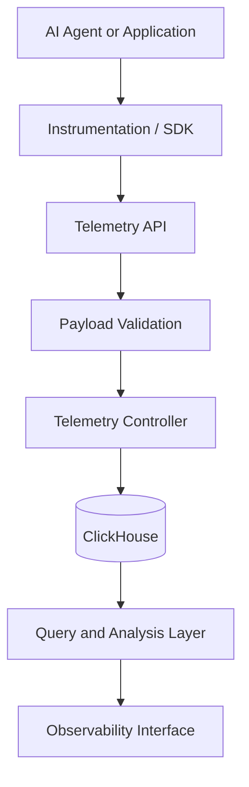

# ASI-Telemetry

[](./LICENSE)
[](https://nodejs.org/)
[](https://www.typescriptlang.org/)
[](https://turbo.build/repo)
[](https://github.com/ujjwalkat07/ASI-Telemetry/issues)
[](https://github.com/ujjwalkat07/ASI-Telemetry/stargazers)

**Observability infrastructure for AI agents.**

ASI-Telemetry is an open-source observability platform designed to make AI agent execution easier to inspect, debug, and monitor. It brings together execution traces, logs, metrics, workflow visibility, and agent health monitoring to help developers understand what their agents are doing and where failures occur.

- **Trace** agent execution and inspect application behavior.
- **Monitor** operational metrics and agent health.
- **Debug** failures using structured telemetry.
- **Understand** workflows through execution-level visibility.
- **Extend** the platform through a modular monorepo architecture.

---

## Table of Contents

- [Overview](#overview)
- [Why ASI-Telemetry](#why-asi-telemetry)
- [Core Capabilities](#core-capabilities)
- [Architecture](#architecture)
- [Technology Stack](#technology-stack)
- [Getting Started](#getting-started)
- [Telemetry API](#telemetry-api)
- [Development](#development)
- [Project Structure](#project-structure)
- [Roadmap](#roadmap)
- [Contributing](#contributing)
- [License](#license)

## Overview

AI agents introduce operational challenges that traditional application monitoring does not always address. A single agent task may involve multiple execution steps, tool calls, messages, model interactions, and asynchronous operations.

ASI-Telemetry aims to provide a unified view of this execution lifecycle.

- **Execution visibility:** Understand the sequence of operations performed by an agent.
- **Operational monitoring:** Collect telemetry to help investigate performance and reliability.
- **Failure investigation:** Use recorded telemetry to identify errors and unexpected behavior.
- **Workflow observability:** Inspect agent execution paths and relationships between operations.
- **Agent health:** Monitor operational signals to understand the state of an agent system.

## Why ASI-Telemetry

AI systems need more than request counts and application logs. Developers also need visibility into the behavior and execution paths of their agents.

ASI-Telemetry focuses on making this information easier to collect and investigate.

- **Agent-centric observability:** Organize monitoring around AI agent execution rather than only conventional HTTP requests.
- **Structured telemetry:** Provide a foundation for collecting and querying operational data.
- **Centralized visibility:** Bring execution information and operational signals into one observability workflow.
- **Modular architecture:** Keep applications and reusable packages organized in a maintainable monorepo.
- **Open-source development:** Allow developers to inspect, extend, and contribute to the platform.

## Core Capabilities

| Capability | Description |
| --- | --- |
| Execution tracing | Inspect agent execution and operation sequences. |
| Logs | Collect and investigate application and agent events. |
| Metrics | Capture operational measurements for monitoring. |
| Workflow visualization | Understand execution paths and relationships. |
| Agent health monitoring | Observe signals associated with agent reliability and availability. |
| Telemetry ingestion | Receive and validate telemetry submitted by instrumented applications. |
| Persistent storage | Store telemetry for subsequent analysis and querying. |

The available capabilities depend on the current implementation and integrations in the repository. Refer to the source code for the latest implementation details.

## Architecture

ASI-Telemetry separates telemetry production, ingestion, and storage to establish a foundation for agent observability.



### Data Flow

- **Instrumentation:** An agent or application produces telemetry.
- **Ingestion:** The telemetry is submitted to the backend through an HTTP endpoint.
- **Validation:** Incoming payloads are validated before processing.
- **Processing:** The controller handles accepted telemetry.
- **Storage:** Telemetry records are persisted in ClickHouse.
- **Analysis:** Stored data can be queried by downstream observability components.

The diagram describes the telemetry pipeline at a conceptual level. The exact integrations and execution paths depend on the implemented components.

## Technology Stack

| Technology | Purpose |
| --- | --- |
| TypeScript | Application and package development |
| Node.js | JavaScript runtime |
| npm workspaces | Dependency and workspace management |
| Turborepo | Monorepo task orchestration |
| FastAPI | HTTP telemetry ingestion |
| ClickHouse | Telemetry storage and analytical queries |

## Getting Started

### Prerequisites

- Node.js 24 or later
- npm 11.19.0 or a compatible npm version
- Git
- Python and the configured Python dependencies if running the FastAPI backend
- A running ClickHouse instance if exercising persistent telemetry ingestion

### Installation

Clone the repository and install its dependencies.

```bash
git clone https://github.com/ujjwalkat07/ASI-Telemetry.git
cd ASI-Telemetry
npm install
```

### Run the Development Tasks

Start the development tasks configured across the workspaces.

```bash
npm run dev
```

Build the workspaces.

```bash
npm run build
```

Run linting.

```bash
npm run lint
```

Check types.

```bash
npm run check-types
```

Format TypeScript, TSX, and Markdown files.

```bash
npm run format
```

These commands are defined by the root package configuration. The applications and packages started by each command depend on their individual workspace scripts.

### Environment Configuration

- Configure the database connection and other required environment variables according to the relevant application's configuration.
- Keep credentials and API keys in local environment files.
- Use example environment files where available.
- Never commit secrets, access tokens, or production credentials.

Refer to the application-specific configuration files for the exact variable names and required values.

## Telemetry API

ASI-Telemetry exposes HTTP endpoints for telemetry ingestion.

### Endpoints

| Method | Endpoint | Success Status | Purpose |
| --- | --- | --- | --- |
| `POST` | `/metrics` | `201 Created` | Submit metric telemetry. |
| `POST` | `/telemetry` | `201 Created` | Submit telemetry payloads. |

### Example Request

The following example illustrates the HTTP request structure. Replace the sample payload with the schema accepted by the current backend.

```bash
curl -X POST http://localhost:8000/telemetry \
  -H "Content-Type: application/json" \
  -d '{
    "example": "replace-with-a-valid-telemetry-payload"
  }'
```

- The request body is parsed and validated by the FastAPI request model.
- Accepted requests are passed to the telemetry controller.
- Telemetry persistence is handled by the backend.
- Invalid request payloads are rejected by request validation.

**Note:** The example payload is illustrative and is not guaranteed to satisfy the application's `MetricPayload` schema. Check the backend models before using it in an integration.

## Development

ASI-Telemetry uses a workspace-based repository structure to organize applications and reusable packages.

### Development Guidelines

- Keep application-specific logic within the appropriate workspace.
- Prefer reusable modules for functionality shared between applications.
- Validate incoming telemetry before processing or persisting it.
- Keep database operations and API concerns separated.
- Add tests when introducing new behavior or fixing bugs.
- Document configuration changes and externally visible API changes.
- Avoid committing generated files, credentials, and local environment configuration.

### Quality Checks

Run the available checks before submitting a change.

```bash
npm run lint
npm run check-types
npm run build
```

Run these commands from the repository root. Additional test commands may be available within individual workspaces.

## Project Structure

The repository is organized as a monorepo.

```text
ASI-Telemetry/
├── apps/              # Applications and services
├── packages/          # Reusable packages
├── .vscode/           # Editor configuration
├── package.json       # Root scripts and workspace configuration
├── turbo.json         # Turborepo task configuration
├── tsconfig.json      # TypeScript configuration, if present
├── LICENSE            # MIT license
└── README.md          # Project documentation
```

The directory descriptions are conceptual. Consult the actual workspace contents for the definitive list of applications, packages, and configuration files.

## Roadmap

Potential areas for continued development include:

- [ ] Expand agent execution tracing and correlation across operations.
- [ ] Improve telemetry filtering, querying, and investigation workflows.
- [ ] Add integrations for common agent frameworks and model providers.
- [ ] Improve workflow visualization and execution-level debugging.
- [ ] Add dashboards for latency, failures, and operational metrics.
- [ ] Expand automated testing and deployment documentation.
- [ ] Publish integration guides and API reference documentation.

These items represent potential development directions, not a statement that the features are currently implemented or scheduled for release.

## Contributing

Contributions are welcome.

- Check the existing issues before starting substantial work.
- Open an issue to discuss larger changes or proposed features.
- Fork the repository and create a focused feature branch.
- Follow the existing code style and workspace conventions.
- Run the available lint, type-check, and build commands.
- Include tests and documentation for relevant changes.
- Submit a pull request with a clear explanation of the change and its motivation.

For bugs and feature requests, use the [GitHub Issues](https://github.com/ujjwalkat07/ASI-Telemetry/issues) page.

## License

ASI-Telemetry is distributed under the [MIT License](./LICENSE).

Copyright (c) 2026 Devrithm Labs.
